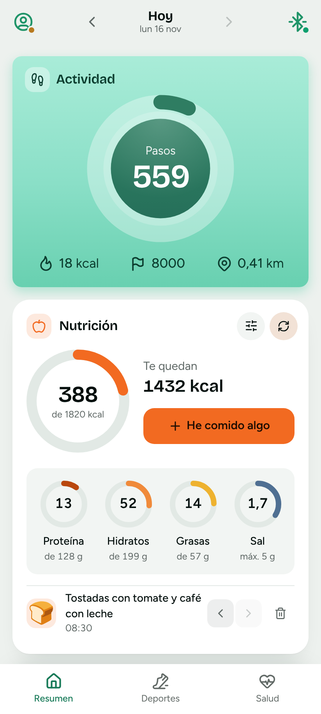
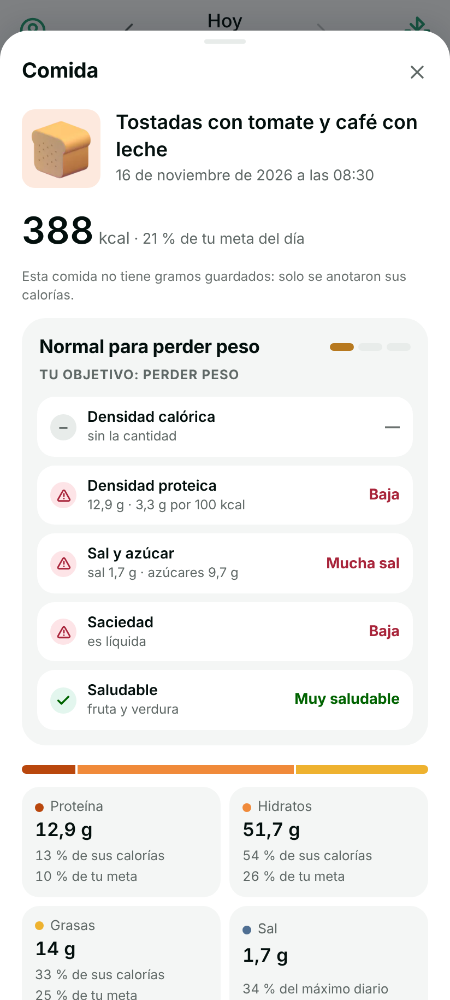
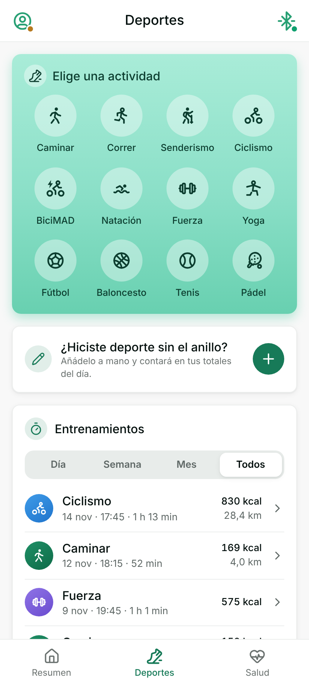
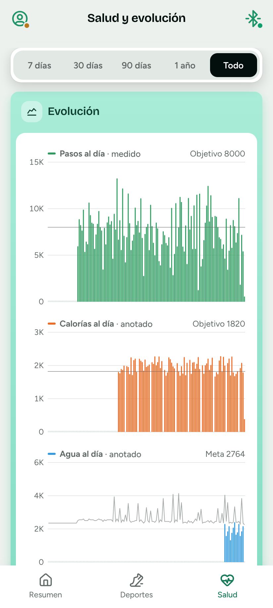
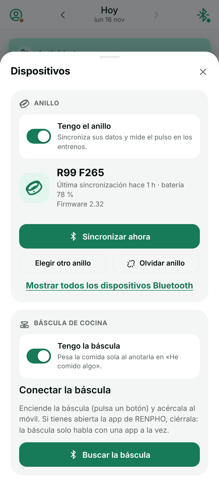

# SmartHealth

App de Android para el anillo inteligente **R99 F265** (Bluetooth, protocolo YCBT) que suma alimentación y entrenos con GPS y navegación. Sin cuenta ni servidor: los datos viven en el móvil.

  
  
  
  
  

*Capturas con los datos de ejemplo del modo demostración.*

## Descargar e instalar

1. En [Releases](../../releases) baja el último `apk-N` (APK de Android).
2. Instálalo permitiendo «instalar apps de esta fuente».
3. Las actualizaciones se instalan encima sin perder datos. Haz copias desde Perfil → Datos y copias de seguridad.

Sus cálculos (calorías, sueño, pulso) son estimaciones, no un producto sanitario. Proyecto independiente, sin relación con el fabricante del anillo.

## Qué hace

- **Anillo**: sincroniza pasos, calorías, distancia, sueño, pulso y oxígeno, a mano o con la app abierta. Si una noche no la guarda el anillo, la estima con el pulso, la respiración y los pasos (o, si no lo llevabas puesto, por los huecos de actividad), se ajusta con las noches que sí guardó el anillo o que corriges, y se puede corregir a mano; la hoja del sueño dice cuánto se habría equivocado en tus propias noches. Si dejas el anillo de noche, dale a la app acceso a los «datos de uso» de Android (Ajustes → Objetivos y medición → «Dar acceso»): lee solo **a qué horas** se enciende la pantalla (nunca qué apps ni qué haces, y nada sale del móvil) y con eso la hora de acostarte y levantarte sale mucho más precisa.
- **Resumen, Deportes y Salud**: actividad del día, nutrición con indicadores a tu gusto (hasta dos filas de cuatro), doce deportes con entreno en vivo y gráficos de evolución configurables con objetivo de peso.
- **Navegación guiada** (opcional): destino y ruta adecuada al deporte sobre un mapa de OpenStreetMap guardado por zonas, con avisos por zumbidos y vibración.
- **Alimentación** (sin internet): anota con la báscula de cocina Bluetooth (RENPHO ES-SNG01 y parecidas), código de barras, foto de la tabla nutricional, palabras o a mano. Incluye una base de unos 240 000 productos de España, una tabla de más de 1000 alimentos, «Mis productos» y «Mis platos».
- **Cada comida** se valora para tu objetivo, se pueden cambiar sus cantidades, y la app propone recetas y productos de súper cuando repites comidas poco adecuadas.
- **Versión web para móviles**: la misma app con anillo y báscula simulados, servida desde un PC con un script de Python (`beta-web/`, release `beta-web-N`).

Accesibilidad AA en claro y oscuro y política de contenido estricta, sin tráfico sin cifrar.

## Servicios externos

La app solo usa internet para dos cosas:

- **Open Food Facts**: la foto del producto en la miniatura. Solo se envía el código de barras.
- **OpenStreetMap vía Overpass**: el mapa de la zona al navegar, una vez por zona y guardado en el móvil.

Todo lo demás funciona sin red.

## Límites conocidos

- Con la pantalla apagada en un entreno, algunos móviles (Xiaomi/HyperOS) pueden parar el GPS o el pulso; la app avisa de qué ajustes revisar.
- El anillo no conoce el cambio de hora: los registros entre un cambio y la siguiente sincronización salen una hora desplazados.
- La báscula no documenta su protocolo y se aprende con la persona al emparejarla.

## Desarrollo

`npm run check` (tipos y unitarias) y `npm run e2e` (navegador con el anillo simulado). El APK solo se compila en el CI: *Actions → APK de Android → Run workflow*. Necesita los secretos de firma `ANDROID_KEYSTORE_B64`, `ANDROID_STORE_PASSWORD`, `ANDROID_KEY_ALIAS` y `ANDROID_KEY_PASSWORD` y la variable `FIRMA_SHA256`. Atribuciones y licencias de terceros: [`docs/atribuciones.md`](docs/atribuciones.md).
